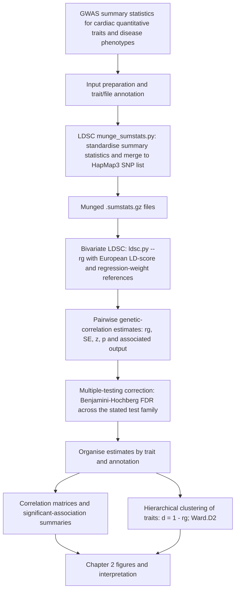

# Chapter 2 genetic-correlation workflow

## Analysis sequence

## What each stage did

1. **GWAS summary-statistic collection and annotation.** Summary statistics were assembled for quantitative cardiac phenotypes and binary cardiovascular disease phenotypes. `metadata/traitlist.tsv` records trait names, categories and plotting colours. `metadata/summary_statistic_file_mapping_original.txt` preserves the archived mapping between trait categories and source summary-statistic filenames.
2. **Summary-statistic munging.** LDSC `munge_sumstats.py` was used to prepare inputs and match variants to the HapMap3 reference SNP list (`--merge-alleles`). The archived munging job refers to six input directory/pattern groups. The cleaned SLURM template exposes the input directory and file pattern as job variables rather than embedding personal HPC paths.
3. **Pairwise genetic-correlation estimation.** The archived commands use `ldsc.py --rg` with European LD-score reference files and corresponding regression weights. The resulting estimates include `rg`, standard error, z-score and p-value fields.
4. **Multiple-testing correction.** The thesis captions state that Benjamini–Hochberg FDR was calculated across 10,877 correlations. The archived results table contains a `q` column. The cleaned plotting script uses the supplied `q` values and does not silently recalculate them.
5. **Trait organisation and visualisation.** Results were joined to trait annotations and displayed as correlation matrices. Positive and negative genetic correlations were distinguished by colour; statistical significance was marked using FDR thresholds. Disease-associated correlations were also summarised by counts.
6. **Hierarchical clustering.** The thesis describes conversion of genetic correlations to dissimilarities using `d = 1 - rg`, followed by Ward.D2 hierarchical clustering. The cleaned plotting script makes this operation explicit and produces both a dendrogram and a correlation matrix in clustered trait order.
7. **Thesis outputs.** The archived figure files are retained in `figures/` as historical outputs, not regenerated outputs from the cleaned script.

## Interpretation

A genetic correlation describes covariance between genome-wide genetic effects. It is evidence of shared polygenic architecture, not proof that the same causal variant drives both traits, and not evidence of a causal direction. Ward.D2 branch lengths represent relative dissimilarity under the chosen distance definition; they should not be interpreted as physical, developmental or causal distances.

## Provenance limitation

The archived result table is not a clean one-row-per-pair table. It contains repeated records, including pairs with more than one distinct `rg`, `p` and `q` value. The cleaned script checks this and stops if conflicting values remain. The final historical analysis output/logs are needed to identify which record set generated the submitted thesis figures. No conflicting record has been selected arbitrarily in this repository build.
